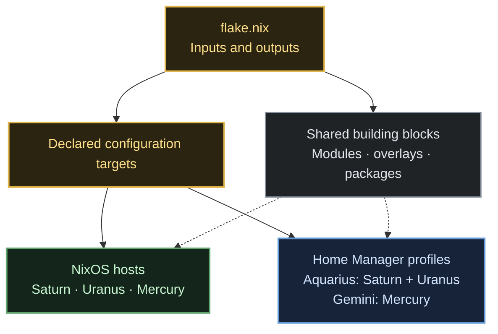
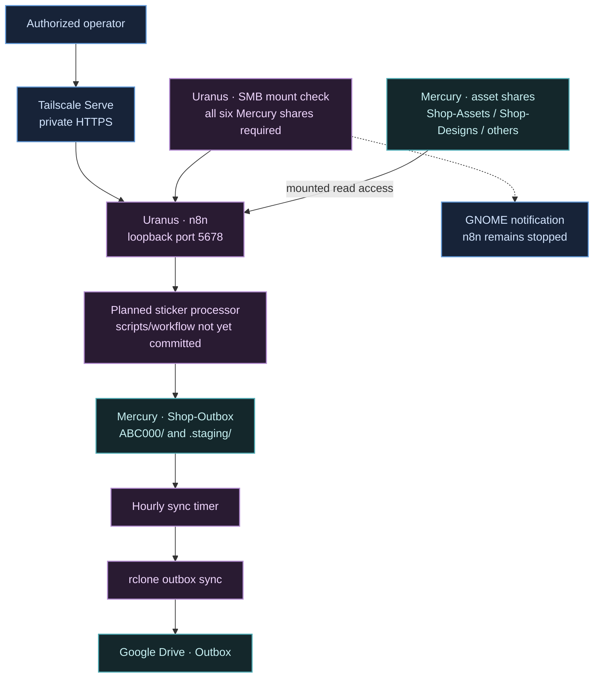

# NixOS Configuration — Quick Reference

A flake-managed setup with three NixOS hosts, three standalone Home Manager outputs, and shared modules. The diagrams are intentionally top-to-bottom for narrow screens; configuration files are grouped instead of shown individually.

## Architecture



### Standalone legend

```mermaid
flowchart TB
    Core["Gold · flake / core"]
    Host["Green · NixOS host"]
    Profile["Blue · user / Home Manager profile"]
    Service["Purple · service / process"]
    Data["Teal · storage / data"]
    Shared["Gray · shared configuration"]
    DirectA["Solid line"] --> DirectB["Direct dependency / data flow"]
    OptionalA["Dashed line"] -.-> OptionalB["Supporting / optional relationship"]

    classDef core fill:#2b2410,stroke:#e0b44b,color:#ffe08a;
    classDef host fill:#14251b,stroke:#62a66f,color:#c8f7d2;
    classDef profile fill:#172338,stroke:#6098d8,color:#d3e5ff;
    classDef service fill:#291b32,stroke:#b28bd0,color:#f0d7ff;
    classDef data fill:#14272b,stroke:#4eabb4,color:#c7f1f3;
    classDef shared fill:#202326,stroke:#89939f,color:#e1e7ed;
    classDef neutral fill:#1e2023,stroke:#717b86,color:#e8e8e8;
    class Core core;
    class Host host;
    class Profile profile;
    class Service service;
    class Data data;
    class Shared shared;
    class DirectA,DirectB,OptionalA,OptionalB neutral;
```



## Hosts and users

| Host | Role | Home Manager |
|---|---|---|
| **Saturn** | Desktop / laptop | `aquarius@saturn` |
| **Uranus** | Desktop, local AI, automation | `aquarius@uranus` |
| **Mercury** | Headless storage and application server | `gemini@mercury` |

Aquarius administers Saturn and Uranus. Gemini administers Mercury. Mercury also has Samba-oriented accounts for file access; service accounts such as `rclone-sync` are not interactive user profiles.

## Services and data flow



- **Sticker paths:** assets are mounted under `/srv/sticker-automation/assets/`; finished files and staging live in Mercury's `Shop-Outbox` share. `.staging/` is excluded from Google Drive sync.
- **Startup dependency:** if any required SMB share fails to mount, n8n does not start; a retry timer attempts recovery and desktop notifications report mount failures.
- **Implementation status:** the sticker-processing scripts and exported n8n workflow are not yet present in this repository; the process node above shows the intended flow, not a completed end-to-end pipeline.
- **Manual production step:** inspect the sheet preview, then print and cut in Cricut Design Space.

## Useful paths

- `flake.nix` — flake inputs, packages, overlays, and configuration outputs.
- `hosts/{saturn,uranus,mercury}/` — host-specific configuration bundles.
- `hosts/common.nix`, `hosts/desktop.nix` — shared system baselines.
- `modules/{nixos,home-manager}/`, `pkgs/`, `overlays/` — reusable components.
- `home-manager/{aquarius,gemini}/` — user profile bundles.
- `hosts/uranus/STICKER-AUTOMATION.md` — sticker service setup notes.

## Rebuild

```bash
sudo nixos-rebuild switch --flake .#uranus
sudo nixos-rebuild switch --flake .#mercury
home-manager switch --flake .#aquarius@uranus
```

Run each command on the corresponding machine/profile, and review the host-specific setup notes before enabling services. Secrets and OAuth credentials belong in local secret/config files, not in the repository. The Windows VM uses a PCIe ACS override workaround; review its isolation trade-off before treating that guest as untrusted.

## Maintenance review toolkit

- `AGENTS.md` — repository-wide instructions for AI assistants reviewing or modifying this configuration.
- `CODE_REVIEW.md` — prioritized static review findings and validation limits.
- `TODO.md` — human and AI work items, ordered by risk.
- `AI_PROMPTS.md` and `prompts/` — reusable task prompts for adding users/hosts, consolidation, service hardening, and CI. The original reviewer-profile prompt is promoted to `AGENTS.md`.
